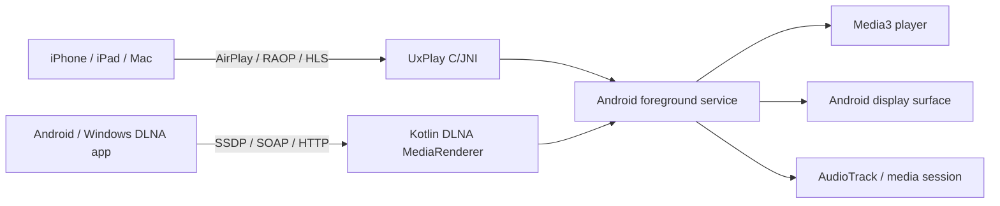

# AirPlay & DLNA Receiver for Android

[](https://github.com/GolLight/android-airplay-server)
[](https://github.com/GolLight/android-airplay-server/releases)
[](https://github.com/GolLight/android-airplay-server/blob/main/LICENSE)
[](https://github.com/GolLight/android-airplay-server/actions/workflows/apk.yml)
[](https://github.com/GolLight/android-airplay-server/releases)

An open-source AirPlay and DLNA receiver for Android and Android TV. It turns an Android device into a wireless display and media renderer: iPhone, iPad and Mac can use AirPlay for screen mirroring, audio and video, while Android and Windows DLNA sender apps can cast videos, music and pictures over the local network. AirPlay support is based on [UxPlay](https://github.com/FDH2/UxPlay).

[](https://github.com/GolLight/android-airplay-server/releases/latest)

<video loop src='https://github.com/user-attachments/assets/79ed7c0c-0102-43cc-8816-4f00ce6a4199' alt="demo" width="200" style="display: block; margin: auto;"></video>

## Compatibility

- Android 7.0+, including Android TV and compatible Android projectors
- AirPlay senders on the same local network, including iOS/iPadOS and macOS
- DLNA senders on the same local network, including compatible Android and Windows apps
- Media URLs must be reachable by the Android receiver; support for a particular app depends on the URL and codec it provides

## Features

### AirPlay

- Screen mirroring with H.264 and H.265 (HEVC) video decoding
- Audio streaming with AAC-ELD, AAC-LC and ALAC audio decoding
- AirPlay video playback with HLS, downloads and remote controls
- Music playback with track information, cover art, lyrics and remote controls
- Automatic resolution and display mode switching, Picture-in-Picture and Android TV navigation
- Optional PIN authentication
- Video resolution, overscan and frame-rate controls
- Audio latency controls and software decoder fallback
- Debug overlay with real-time statistics such as FPS, bitrate, codec and resolution
- Android media-session integration with notification controls
- Wired secondary display over USB tethering

### DLNA

- Standard DLNA MediaRenderer discovery over SSDP
- `AVTransport`, `RenderingControl` and `ConnectionManager` services
- Video playback through Media3, including HTTP/HTTPS media and HLS where supported
- Music playback with title, artist, album art, lyrics and transport controls
- JPEG and PNG image casting with background download and decode
- Play, pause, stop, seek, volume and mute controls where the sender supports them
- SOAP event subscriptions so sender progress follows the receiver state
- AirPlay and DLNA sessions are isolated and share one active playback surface

## Usage

1. Install the APK from the [GitHub Releases](https://github.com/GolLight/android-airplay-server/releases) page.
2. Open the app on the Android TV or projector and start the receiver. Grant the overlay permission if background launch is enabled.
3. Keep the sender and receiver on the same local network. A fresh installation advertises a stable name such as `镜像投屏1234`; the name can be changed in Settings.
4. On iPhone/iPad or Mac, choose the receiver from Screen Mirroring or AirPlay.
5. In an Android or Windows app that supports DLNA, choose the receiver from the Cast/Play to device list.

DLNA media casting does not provide universal Android full-screen mirroring. Full-screen Android mirroring depends on the sender phone and its supported protocol.

> [!WARNING]
> DRM-protected content, such as content from the Apple TV application, is not supported. Actual quality depends on the source stream, network and Android hardware decoder.

## Configure from ADB

On devices without a display, settings can also be changed over ADB. The receiver is protected by `android.permission.DUMP` so regular installed apps cannot change them. Values are passed as text using `--es`. Using `adb shell`:

```bash
export KEY="server_name" VALUE="Speaker"
am broadcast -n io.github.jqssun.airplay/.SettingsReceiver -a io.github.jqssun.airplay.SET_SETTING --es key "$KEY" --es value "$VALUE"
```

To list all settings with their current values as JSON:

```bash
am start -n io.github.jqssun.airplay/.MainActivity
am broadcast -n io.github.jqssun.airplay/.SettingsReceiver -a io.github.jqssun.airplay.LIST_SETTINGS
```

## Implementation

AirPlay/RAOP and FairPlay/HLS handling use the C-based [UxPlay](https://github.com/FDH2/UxPlay) library through a JNI bridge. AirPlay audio is decoded by MediaCodec or FFmpeg's AAC/ALAC decoders, and mirroring video is rendered through Android `SurfaceView` and MediaCodec.

The DLNA receiver is a Kotlin module built on Android networking and Media3. It exposes SSDP discovery, HTTP device descriptions, SOAP control endpoints and event notifications. Video and music use the Media3 player; images are downloaded and decoded off the main thread. AirPlay and DLNA share the foreground service and display pipeline while keeping protocol sessions separate.

When using USB tethering, the Android device can act as a reliable secondary display over a wired connection. Apple devices natively support USB tethering over CDC-NCM, so on Android devices that default to RNDIS, you may need to switch to CDC-NCM over ADB:

```bash
adb shell settings put global tether_force_usb_functions 1
```



CMake is used for native C/C++ components under [`app/src/main/cpp`](app/src/main/cpp). Submodules must be initialized before building:

```bash
git submodule update --init --recursive
./gradlew assembleDebug
```

The release build includes `arm64-v8a`, `armeabi-v7a` and `x86_64`. See the [CI workflow](https://github.com/GolLight/android-airplay-server/blob/main/.github/workflows/apk.yml) for reproducible build details.

## Credits

- [UxPlay](https://github.com/FDH2/UxPlay) for AirPlay/RAOP and FairPlay support
- [FFmpeg](https://ffmpeg.org) for the lossless audio decoder
- [Media3](https://github.com/androidx/media) for media playback components
- [Next Player](https://github.com/anilbeesetti/nextplayer) for the video player foundation
- Based on the original [jqssun/android-airplay-server](https://github.com/jqssun/android-airplay-server) repository

This fork was developed with OpenAI Codex.

Maintenance policy: `main` is this fork's maintained branch, including DLNA and AirPlay improvements. `sync/upstream-main` integrates new upstream changes by rebasing the fork's commits onto the latest upstream `main` for review before updating this fork's `main`. Contributions back to the original repository are prepared separately; DLNA is maintained in this fork and is excluded from those contributions. Development is assisted by OpenAI Codex.

---

Disclaimer: This project is not affiliated with Apple Inc.
